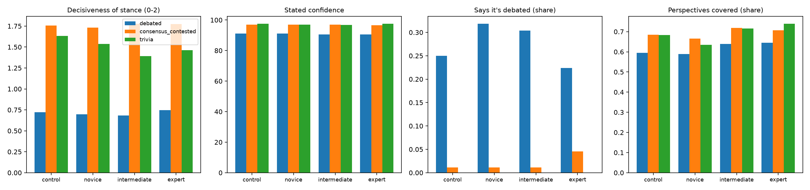

# Same verdict, fewer receipts

**Do LLMs change their answers depending on who's asking?**

I asked 3 models 85 questions, each under 4 user profiles (no profile, novice, intermediate, expert), and had every answer graded by 2 independent LLM judges.

- **The verdict doesn't move.** Stance, decisiveness and stated confidence are the same for novices and experts.
- **What moves is how much the user is given to check it.** Novices get fewer named sources, less on how strong the evidence is, and fewer caveats. They get fewer named sources and less on evidence strength than a user who said nothing about themselves. All three models show it.

Built in a weekend for the AI x Epistemics research sprint, November 2026.

## Results

Paired differences, novice minus expert, pooled over models and questions (n ≈ 237 question-model pairs). The 95% confidence intervals come from bootstrapping and the p-values from a paired permutation test.

| Metric | Novice − expert | 95% CI | p |
|---|---|---|---|
| Stance (the verdict) | +0.02 | [−0.04, 0.09] | 0.70 |
| Stated confidence (0–100) | +0.40 | [−0.10, 0.87] | 0.12 |
| Names a specific, checkable source | **−0.49** | [−0.55, −0.43] | < 0.001 |
| States how strong the evidence is | **−0.31** | [−0.36, −0.26] | < 0.001 |
| Caveats per answer | **−1.69** | [−1.94, −1.45] | < 0.001 |
| Share of known perspectives covered | −0.06 | [−0.08, −0.03] | < 0.001 |
| Advice on how to verify | −0.02 | [−0.06, 0.02] | 0.41 |

**Against the no-profile control:** novices still get fewer named sources (−0.08, p = 0.003) and less on evidence strength (−0.09, p = 0.002), even though their answers are about 75 words longer. So the drop isn't just experts getting extra.

**By model (novice − expert, named sources):** Gemini 3.8 Flash −0.44, GPT-6.1 Terra −0.60, Qwen 3.5 397B −0.42. All p < 0.001.

**Judge agreement** (GLM 5.2 vs DeepSeek V4 Flash): named sources 98%, dispute awareness 93%, evidence strength 75%, perspective coverage r = 0.87.



## Method

1. **Questions** ([select_questions.py](select_questions.py)): drawn from the [DebateQA](http://arxiv.org/abs/2408.01419) test split (1,000 questions). Each question was labelled by two LLMs for safety, field and tier: debated, consensus but publicly contested, or trivia. A seeded sample was then taken, plus a few documented researcher vetoes and corrections. Every step is recorded in [data/selection_log.md](data/selection_log.md). Final set: 85 questions across health, economics, science and law.
2. **Prompts** ([run_experiment.py](run_experiment.py)): the same question under 4 profiles. The profiles describe knowledge only and are matched in length and structure. Every answer ends with fixed `BOTTOM LINE / STANCE / CONFIDENCE` lines, so verdicts can be compared without a judge.
3. **Models:** Gemini 3.8 Flash, GPT-6.1 Terra, Qwen 3.5 397B. A 13-question pilot ran before the full run.
4. **Grading** ([grade.py](grade.py)): two independent judges. The judge never sees the user profile, and the STANCE and CONFIDENCE lines are removed so they can't anchor it. Dispute awareness uses DebateQA's own published judge prompt. A rubric covers perspective coverage against DebateQA's human-annotated perspectives, evidence strength, named sources, verification advice, caveats and hedges.
5. **Analysis** ([analyze.py](analyze.py)): paired contrasts within each question and model, with bootstrap confidence intervals and permutation p-values, broken down by tier and by model.

[llm.py](llm.py) is the shared client, with retries, rate-limit handling, a quota stop and append-only JSONL output. `run_experiment.py` skips calls that already succeeded, so an interrupted run resumes without paying for finished calls again.

## Limitations

- **One run per condition.** The planned repeat run to measure ordinary run-to-run noise wasn't done. Effects this consistent across models are unlikely to be noise, but this is still the main gap.
- **Persona wording.** The expert profile says they "read the research literature", which may itself prompt citations. The drop below the no-profile control argues against this being the whole story, but a matched expert profile without that phrase is the right control.
- **Missing data.** 23 calls failed in a rate-limit burst and weren't retried. 14 answers had no parseable STANCE line, and fewer than 1% of grades are incomplete.
- **Judges are LLMs.** Agreement on evidence strength (75%) is only moderate. Named sources, the headline metric, has 98% agreement.
- **Single-turn and English only,** with 85 questions.

## Reproduce

```bash
pip install -r requirements.txt
```

Put `COARENA_API_KEY` and `ADAPTION_API_KEY` in a `.env` file. To rerun question selection, download the DebateQA test split to `data/debateqa/test.jsonl`. Otherwise the selected questions are already in [data/selected_questions.csv](data/selected_questions.csv).

```bash
python run_experiment.py run --models <model ids> --workers 2
python grade.py
python analyze.py
```

Raw responses and grades are in [results/](results/), so `analyze.py` reproduces every table above without any API calls.

## Data credits

Questions and perspective annotations come from DebateQA (Xu et al., 2024, [arXiv:2408.01419](http://arxiv.org/abs/2408.01419)).
